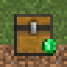
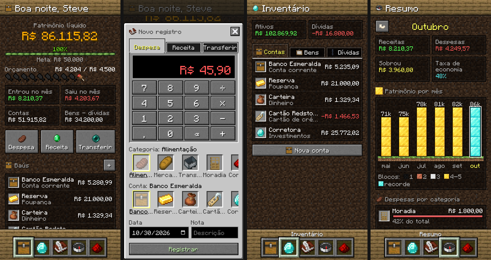

<p align="center"></p>

<h1 align="center">Baú</h1>

<p align="center"><b>Seu patrimônio, bloco por bloco.</b> Um app Android de ativos pessoais com a cara do Minecraft.</p>

<p align="center"></p>

O Baú anota contas, gastos, receitas, bens e dívidas e mostra o seu patrimônio líquido, tudo no próprio aparelho, sem
cadastro e sem internet. A arquitetura segue o [Tally](https://github.com/IamAndelib/Tally-android): uma `WebView`
sobre arquivos HTML/CSS/JS locais e uma Activity em Java que guarda os dados e cuida do backup. A interface usa as
texturas, a fonte e os sons do Minecraft, tirados de
[InventivetalentDev/minecraft-assets@26.3](https://github.com/InventivetalentDev/minecraft-assets/tree/26.3).

## O que tem

- **Patrimônio líquido** em destaque: contas + bens − dívidas.
- **Barra de XP = meta.** Defina uma meta de patrimônio e acompanhe a barra encher.
- **Barra de fome = orçamento.** Cada uma das 10 coxas vale 1/10 do orçamento do mês e some conforme você gasta.
- **Baús (contas):** conta corrente, poupança, dinheiro, carteira digital, cartão de crédito, investimentos, cada uma
  com um emblema (item do jogo) à sua escolha. Ajuste de saldo quando a conta não bate com a realidade.
- **Registros com calculadora:** teclado de botões do jogo que aceita contas (`12+3×2`). Despesa, receita e
  transferência entre contas (transferência não conta como gasto).
- **Inventário:** abas Contas, Bens (imóvel, veículo, ouro, ações, cripto…) e Dívidas, com pagamento de parcelas que
  desconta da conta e da dívida. Itens arquivados (vendidos, quitados) ficam separados.
- **Histórico** por mês, com filtro por conta e o saldo corrente da conta em cada registro.
- **Resumo do mês:** receitas, despesas, taxa de economia, gastos por categoria comparados ao mês anterior e o
  patrimônio dos últimos 6 meses em pilhas de blocos inteiros sobre a grama (carvão, cobre, ferro e ouro conforme a
  altura; diamante no maior mês; netherrack quando negativo).
- **Conquistas** com a notificação do jogo: primeiro registro, patrimônio de 1 mil / 10 mil / 100 mil / 1 milhão,
  meta alcançada, mês no azul, mês dentro do orçamento, dívida quitada, 7 dias seguidos, backup feito…
- **Categorias** editáveis (nome e emblema), com 150+ itens e blocos para escolher.
- **Temas:** Superfície (terra), Cavernas (ardósia), Nether e The End. O topo e a barra inferior têm textura de
  madeira, cada um escolhido separadamente em Ajustes (12 madeiras do jogo ou sem madeira); a barra de status do
  Android acompanha a madeira do topo. Sons do jogo e vibração, que podem ser desligados.
- **Janelas animadas:** sobem ao abrir e descem ao fechar, nos mesmos passos (respeita "reduzir animações").
- **Backup** em JSON pelo seletor de arquivos do Android (exportar e importar).
- **Mundo de exemplo** com 6 meses de dados para conhecer o app.

## Compilar

### Android Studio / Gradle

Abra a pasta no Android Studio, ou:

```bash
./gradlew assembleRelease
```

O APK sai em `app/build/outputs/apk/release/`, assinado com a chave de debug da máquina (dá para instalar direto).
O workflow em `.github/workflows/build.yml` faz o mesmo no GitHub Actions e roda os testes da interface.

### Sem Gradle (só as ferramentas do SDK)

`tools/build-apk.sh` monta o APK com `aapt2`, `javac`, `d8`/`dx`, `zipalign` e `apksigner`. No Ubuntu/Debian:

```bash
sudo apt install android-sdk android-sdk-platform-23 dalvik-exchange apksigner
```

```bash
tools/build-apk.sh
```

O resultado é `build/bau.apk` (minSdk 21, targetSdk 34).

## Testar a interface no navegador

A interface roda em qualquer navegador (os dados ficam no `localStorage`):

```bash
cd app/src/main/assets && python3 -m http.server 8000
```

Abra `http://localhost:8000` com a tela no tamanho de um celular. O teste ponta a ponta usa Playwright:

```bash
node tests/e2e.js
```

## Atualizar os assets do Minecraft

Os arquivos em `app/src/main/assets/mc`, `sound/`, `fonts/minecraft.ttf` e os ícones em `res/mipmap-*` são gerados
por `tools/prepare_assets.py` (precisa de `pillow` e `fonttools`):

```bash
git clone --depth 1 --filter=blob:none --sparse -b 26.3 https://github.com/InventivetalentDev/minecraft-assets.git mc-assets
```

```bash
git -C mc-assets sparse-checkout set assets/minecraft/textures assets/minecraft/font assets/minecraft/sounds/random assets/minecraft/sounds/block/chest
```

```bash
python3 tools/prepare_assets.py mc-assets
```

O script copia os itens e blocos usados, recorta os sprites da interface (botões, campos, abas, espaços de inventário,
barras do HUD, notificação de conquista), monta o painel dos containers como nine-slice, desenha a face frontal dos
baús a partir da textura da entidade e gera uma fonte TrueType pixelada a partir de `font/ascii.png` e
`font/accented.png` (com os acentos do português).

## Estrutura

```
app/src/main/
  java/app/bau/ativos/MainActivity.java   WebView, arquivo de dados, backup, botão Voltar
  assets/index.html
  assets/css/app.css                      visual do jogo (nine-slices, HUD, barra de atalhos)
  assets/js/store.js                      dados, saldos, patrimônio, mundo de exemplo
  assets/js/ui.js                         elementos, sons, dinheiro, calculadora, janelas
  assets/js/sheets.js                     janelas de edição
  assets/js/screens.js                    Início, Inventário, Histórico, Resumo, Ajustes
  assets/js/app.js                        navegação, conquistas, backup, ponte com o Android
tools/prepare_assets.py                   gera os assets a partir do repositório do Minecraft
tools/build-apk.sh                        build sem Gradle
tests/e2e.js                              teste ponta a ponta
```

## Licença e créditos

Código sob a licença MIT. Texturas, fonte e sons são do Minecraft, © Mojang AB / Microsoft, usados num projeto de fã
sem fins comerciais e sem vínculo com a Mojang ou a Microsoft. Não publique o app em lojas com esses assets.
Arquitetura inspirada no [Tally](https://github.com/IamAndelib/Tally-android) (MIT).
